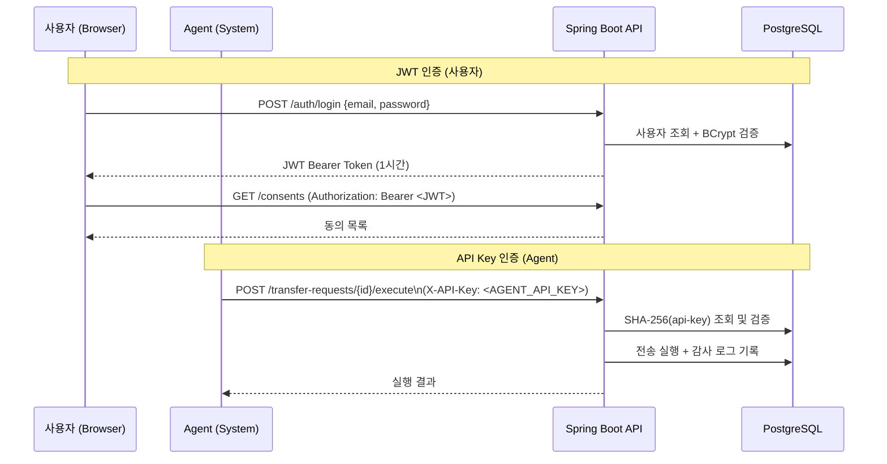
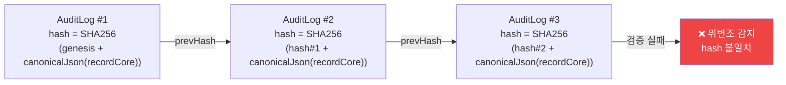

# ConsentLedger

> **개인정보 전송요구권(마이데이터) 관리 시스템** — SHA-256 해시 체인 감사 로그 + AI 이상 탐지 + MCP 서버 통합

<p align="center">
  
  
  
  
  
  
</p>

<p align="center">
  <a href="https://github.com/teriyakki-jin/ConsentLedger/actions/workflows/ci.yml">
    
  </a>
  
  
</p>


---

## 목차

- [프로젝트 소개](#프로젝트-소개)
- [핵심 기능](#핵심-기능)
- [기술 스택](#기술-스택)
- [시스템 아키텍처](#시스템-아키텍처)
- [AWS 인프라](#aws-인프라)
- [CI/CD 파이프라인](#cicd-파이프라인)
- [데이터 모델](#데이터-모델)
- [Quick Start (로컬)](#quick-start-로컬)
- [API Reference](#api-reference)
- [MCP 서버 연동](#mcp-서버-연동)
- [테스트](#테스트)
- [환경변수](#환경변수)
- [사용 시나리오](#사용-시나리오)

---

## 프로젝트 소개

**ConsentLedger**는 **개인정보 전송요구권(마이데이터)**의 동의·요청·승인·감사 흐름을 구현한 개인 프로젝트입니다.

동의 생성부터 전송 요청 승인·실행까지의 이력을 기록하고, 관리자 화면과 MCP 도구로 감사 로그를 조회·검증할 수 있도록 구현했습니다.

### 왜 만들었나

| 문제 | ConsentLedger의 접근 |
|------|---------------------|
| 감사 로그 위변조 탐지 불가 | SHA-256 **해시 체인**으로 이력 변경 여부 검증 |
| 보안 위협 수동 분석의 한계 | **OpenAI gpt-4o AI**가 로그 패턴 자동 분석 |
| AI 도구와 시스템 통합 복잡성 | **Spring AI MCP 서버**로 Claude Desktop 직접 연결 |
| 사용자와 Agent의 인증 수단 분리 | **사용자·Agent 인증** (JWT + SHA-256 API Key) 구조 |

---

## 핵심 기능

### 🔐 사용자·Agent 인증 체계
- **사용자**: JWT Bearer 토큰 (1시간 만료)
- **Agent**: `X-API-Key` 헤더 (SHA-256 해시로 DB 저장, 평문 미보관)
- **RBAC**: `USER` / `ADMIN` / `AGENT` 역할 기반 접근 제어

### 🔗 SHA-256 해시 체인 감사 로그
```
payloadHash = SHA-256(canonicalJson(payload))
recordCore  = {action, actor IDs, IP, object, outcome, payloadHash, schemaVersion, ts}
[LogN] hash = SHA-256(prevHash + canonicalJson(recordCore))
[LogN+1] hash = SHA-256(hash_of_LogN + canonicalJson(nextRecordCore))
```
- DB 트리거로 **일반 UPDATE/DELETE 차단** (`audit_logs_immutable`)
- `GET /admin/audit-logs/verify` 로 전체 체인 무결성 검증
- 비관적 잠금으로 동시 삽입 시 해시 체인 직렬화 보장

### 🤖 AI 이상 탐지
OpenAI gpt-4o이 감사 로그를 분석해 4가지 패턴 자동 탐지:

| 패턴 | 설명 |
|------|------|
| `ACCOUNT_TAKEOVER` | 비정상 로그인 시도 패턴 |
| `DATA_EXFILTRATION` | 대량 데이터 접근 |
| `PRIVILEGE_ABUSE` | 권한 남용 |
| `ABNORMAL_HOURS` | 비업무 시간대 접근 |

### 🛠 Spring AI MCP 서버
Claude Desktop 등 MCP 클라이언트와 SSE로 직접 연결. 6개 도구 등록:
`getAuditLogs` · `verifyAuditChain` · `getConsentsByUser` · `getTransferRequests` · `listUsers` · `analyzeAnomalies`

### 📊 전송 요청 상태 머신
```
REQUESTED → APPROVED → COMPLETED
    ↓           ↓
  DENIED      FAILED
```
- `idempotencyKey`와 요청자·요청 내용 비교로 중복 생성 요청 처리
- 비관적 잠금으로 동시 승인/실행 충돌 방지

---

## 기술 스택

| 영역 | 기술 | 선택 이유 |
|------|------|----------|
| **Backend** | Java 17, Spring Boot 3.3.5 | Java 17 기반 백엔드 |
| **Security** | Spring Security, JJWT, BCrypt | 산업 표준 |
| **AI / MCP** | Spring AI 1.0.0, OpenAI gpt-4o (OpenAI) | 모델 호출과 MCP 도구 연동 |
| **Database** | PostgreSQL 16, Spring Data JPA, Flyway | JSONB, 강력한 트랜잭션 |
| **Frontend** | React 19, TypeScript, Vite, Zustand, Axios | 최신 React 기능 |
| **Infra** | Docker, nginx, GitHub Actions | 컨테이너 기반 배포 |
| **Cloud** | AWS EC2, RDS, S3, CloudFront | 실제 운영 환경 구성 |
| **Testing** | JUnit 5, Mockito, Testcontainers, Playwright | 서비스·API·E2E 검증 |
| **Docs** | springdoc-openapi (Swagger UI) | API 문서 자동화 |

---

## 시스템 아키텍처


### 인증 흐름



### 해시 체인 무결성 구조



> DB 트리거(`audit_logs_immutable`)로 일반 UPDATE/DELETE 차단. `GET /admin/audit-logs/verify`로 전체 체인 일괄 검증.

### 패키지 구조

```
src/main/java/com/consentledger/
├── domain/
│   ├── auth/           # JWT 발급/검증
│   ├── user/           # 사용자 관리
│   ├── agent/          # API Key 인증 Agent
│   ├── dataholder/     # 데이터 보유자
│   ├── consent/        # 동의 생성/철회
│   ├── transfer/       # 전송 요청 상태 머신
│   └── audit/
│       ├── anomaly/    # AI 이상 탐지 (OpenAI gpt-4o)
│       ├── demo/       # 데모 시나리오 생성기
│       └── tamper/     # 해시 체인 위변조 시뮬레이터
├── mcp/
│   ├── McpServerConfig.java
│   └── tools/          # @Tool 어노테이션 MCP 도구 6종
└── global/
    ├── config/         # Security, JPA, CORS, PDF
    ├── security/       # JWT Filter, API Key Filter
    ├── exception/      # Global Exception Handler
    └── util/           # HashChain, AuditLogger
```

---

## AWS 인프라

### 배포 아키텍처


### AWS 배포 구성 기록

| 리소스 | 스펙 | 리전 |
|--------|------|------|
| EC2 | t3.micro, Amazon Linux 2023 | eu-north-1 |
| RDS | PostgreSQL 16, db.t4g.micro | eu-north-1 |
| S3 | consentledger-frontend | eu-north-1 |
| CloudFront | E16PKAHHTR1AYQ | Global |

### CloudFront 동작(Behavior) 구성

프론트엔드(S3)와 백엔드(EC2)를 단일 CloudFront 배포로 통합합니다.

| 경로 패턴 | 오리진 | 설명 |
|-----------|--------|------|
| `/api/*` | EC2 (nginx) | API 요청 → Spring Boot, nginx에서 `/api/` prefix 제거 |
| `/*` (기본) | S3 | React SPA 정적 파일 서빙 |

```
브라우저 → CloudFront
  ├── /api/* → EC2 nginx → Spring Boot (rewrite: /api/auth/login → /auth/login)
  └── /*     → S3 (index.html, assets)
```

> **캐시 정책**: `/api/*` 동작은 `CachingDisabled` + `AllViewer` 원본 요청 정책 적용 (Authorization 헤더 포함 전달)

### EC2 초기 설정

```bash
# Amazon Linux 2023 기준
sudo yum install -y docker git
sudo systemctl enable --now docker

git clone https://github.com/teriyakki-jin/ConsentLedger.git /opt/consentledger
cd /opt/consentledger

# 환경변수 설정
cp .env.example .env && vi .env

# ghcr.io 로그인
echo "<GITHUB_PAT>" | sudo docker login ghcr.io -u <USERNAME> --password-stdin

# RDS 연결 모드로 실행
sudo docker compose -f docker-compose.rds.yml up -d
```

---

## CI/CD 파이프라인

`main` 브랜치 push 시 자동 실행:

```
push to main
    │
    ▼
╔══════╗
║ test ║  단위 테스트 (119개) + 통합 테스트 (26개, Testcontainers)
╚══╤═══╝
   │ 성공 시
   ├──────────────────────────────────▶ ╔══════════════════╗
   │                                    ║ deploy-frontend  ║
   │                                    ║ Vite 빌드        ║
   │                                    ║ → S3 sync        ║
   │                                    ║ → CF Invalidate  ║
   ▼                                    ╚══════════════════╝
╔═════════╗
║ publish ║  Docker 빌드 → ghcr.io 푸시 (sha + latest 태그)
╚════╤════╝
     │
     ▼
╔══════════════════╗
║ deploy-backend   ║  SSH → EC2 → docker compose pull → up
╚══════════════════╝
```

| Secret | 설명 | 미설정 시 |
|--------|------|----------|
| `DEPLOY_HOST` | EC2 IP | deploy-backend skip |
| `DEPLOY_USER` | SSH 사용자 | deploy-backend skip |
| `DEPLOY_KEY` | SSH 개인키 (raw PEM) | deploy-backend skip |
| `AWS_ACCESS_KEY_ID` | IAM 키 | deploy-frontend skip |
| `AWS_SECRET_ACCESS_KEY` | IAM 시크릿 | deploy-frontend skip |
| `AWS_REGION` | 리전 | deploy-frontend skip |
| `S3_BUCKET_NAME` | S3 버킷명 | deploy-frontend skip |
| `CLOUDFRONT_DISTRIBUTION_ID` | CF 배포 ID | CF invalidation skip |
| `VITE_API_BASE_URL` | 백엔드 API URL | 빌드 시 환경변수 미주입 |

> `DEPLOY_HOST`가 없으면 백엔드 배포 단계, `S3_BUCKET_NAME`이 없으면 프론트엔드 배포 단계를 건너뜁니다. 그 외 필요한 Secrets가 누락되면 해당 단계가 실패할 수 있습니다.

---

## 데이터 모델

```
users ──────────────────────────────┐
  │ 1:N                             │
consents ◀── transfer_requests ─────┤
  │                                 │
  └── audit_logs (immutable) ───────┘
        │ SHA-256 hash chain
        ▼
  audit_chain_anchor (lock row)
```

### 감사 로그 해시 체인 상세

```sql
-- 무결성 보장: 트리거로 UPDATE/DELETE 차단
CREATE TRIGGER audit_logs_immutable
  BEFORE UPDATE OR DELETE ON audit_logs
  EXECUTE FUNCTION prevent_audit_modification();

-- 해시 계산 (Java)
String payloadHash = HashUtils.sha256(JsonUtils.toCanonicalJson(payload));
// recordCore에는 payloadHash, 마이크로초 단위 ts, 행위자·대상·결과 등이 포함됩니다.
String hash = HashUtils.sha256(prevHash + JsonUtils.toCanonicalJson(recordCore));
```

---

## Quick Start (로컬)

필요 환경: JDK 17, Node.js(Vite 7 지원 버전), Docker Compose.

### 1. 저장소와 DB 준비

```bash
git clone https://github.com/teriyakki-jin/ConsentLedger.git
cd ConsentLedger
docker compose up -d
```

기본 Compose 파일은 PostgreSQL과 pgAdmin을 실행합니다. 백엔드가 시작되면 Flyway가 테이블과 데모 데이터를 준비합니다.

### 2. 백엔드 실행

PowerShell:

```powershell
$env:SPRING_PROFILES_ACTIVE = "local"
$env:APP_JWT_SECRET = "local-demo-only-signing-key-at-least-32-characters"
$env:SPRING_AI_OPENAI_API_KEY = "disabled-for-local-demo"
.\gradlew.bat bootRun
```

Bash:

```bash
export SPRING_PROFILES_ACTIVE=local
export APP_JWT_SECRET=local-demo-only-signing-key-at-least-32-characters
export SPRING_AI_OPENAI_API_KEY=disabled-for-local-demo
./gradlew bootRun
```

위 AI 키는 모델 초기화를 위한 더미 값입니다. AI 분석을 사용하려면 `SPRING_AI_OPENAI_API_KEY`를 본인의 유효한 키로 설정합니다. 이 변수는 로컬 프로필에 지정된 키보다 우선합니다. `.env` 파일을 만드는 것만으로 `bootRun`에 환경변수가 자동 주입되지는 않습니다.

### 3. 프론트엔드 실행

별도 터미널에서 실행합니다.

```bash
cd frontend
npm ci
npm run dev
```

프론트엔드의 `/api/*` 요청은 Vite가 `localhost:8080`으로 전달하면서 `/api` 접두사를 제거합니다.

| 서비스 | 주소 |
| --- | --- |
| 웹 화면 | `http://localhost:5173` |
| 백엔드 | `http://localhost:8080` |
| Swagger UI | `http://localhost:8080/swagger-ui` |
| 헬스 체크 | `http://localhost:8080/actuator/health` |
| MCP SSE | `http://localhost:8080/sse` |
| pgAdmin | `http://localhost:5050` |

### 데모 계정

| 역할 | 이메일 | 비밀번호 |
| --- | --- | --- |
| 관리자 | `admin@consentledger.com` | `admin1234` |
| 사용자 | `user@consentledger.com` | `user1234` |

로컬 데모 데이터 기준입니다. pgAdmin 로그인은 `admin@consentledger.com` / `admin`이며 앱 로그인과 별개입니다.

사용자 계정으로 동의 생성 → 전송 요청 → 승인 → 실행을 확인하고, 관리자 계정으로 감사 로그 조회와 체인 검증을 확인할 수 있습니다.

---

## API Reference

### Auth
| Method | Path | 설명 |
|--------|------|------|
| POST | `/auth/login` | JWT 발급 |

### Consents
| Method | Path | 권한 | 설명 |
|--------|------|------|------|
| POST | `/consents` | USER | 동의 생성 |
| GET | `/consents` | USER | 내 동의 목록 |
| POST | `/consents/{id}/revoke` | USER | 동의 철회 |

### Transfer Requests
| Method | Path | 권한 | 설명 |
|--------|------|------|------|
| POST | `/transfer-requests` | USER·AGENT | 전송 요청 생성 |
| POST | `/transfer-requests/{id}/approve` | USER | 승인 |
| POST | `/transfer-requests/{id}/execute` | 동의 소유자·요청 AGENT | 실행 |

### Admin
| Method | Path | 설명 |
|--------|------|------|
| GET | `/admin/audit-logs` | 감사 로그 조회 (필터링) |
| GET | `/admin/audit-logs/verify` | 해시 체인 무결성 검증 |
| GET | `/admin/audit-logs/analyze?days=7` | AI 이상 탐지 분석 |
| GET | `/admin/reports/audit` | PDF 리포트 다운로드 |
| GET | `/admin/users` | 사용자 목록 |
| GET/PATCH | `/admin/agents/{id}/status` | Agent 관리 |

### Demo (ADMIN)
| Method | Path | 설명 |
|--------|------|------|
| POST | `/admin/demo/anomaly-scenario` | 43개 이상 패턴 로그 생성 |
| POST | `/admin/demo/tamper/{logId}` | 해시 체인 위변조 시뮬레이션 |
| GET | `/admin/demo/tamper/status` | 체인 검증 결과 조회 |

> 전체 API 문서: `http://localhost:8080/swagger-ui`

---

## MCP 서버 연동

Spring AI MCP 서버에 아래 6개 도구를 등록했습니다. MCP 클라이언트의 SSE 연결 설정에 서버 주소와 관리자 토큰을 지정합니다.

| 설정 | 값 |
| --- | --- |
| 전송 방식 | SSE |
| 서버 주소 | `http://localhost:8080/sse` |
| 인증 헤더 | `Authorization: Bearer <ADMIN_JWT>` |

클라이언트별 원격 SSE·헤더 지원 여부와 설정 형식은 다를 수 있습니다. 토큰이 만료되면 다시 로그인해 갱신해야 합니다.

| 도구 | 기능 |
| --- | --- |
| `getAuditLogs` | 감사 로그 필터 조회 |
| `verifyAuditChain` | 감사 로그 체인 검증 |
| `getConsentsByUser` | 지정한 사용자의 동의 조회 |
| `getTransferRequests` | 전송 요청 목록 조회 |
| `listUsers` | 사용자 목록 조회 |
| `analyzeAnomalies` | 지정 기간의 이상 징후 분석 |

이 도구들은 조회·검증·분석용이며 모두 `ADMIN` 권한을 요구합니다. Agent의 `X-API-Key` 인증과는 별도입니다.

구현: [McpServerConfig](src/main/java/com/consentledger/mcp/McpServerConfig.java) · [MCP 도구](src/main/java/com/consentledger/mcp/tools)

---

## 테스트

```bash
# 단위 테스트 (Mockito, @WebMvcTest)
./gradlew test

# 통합 테스트 (Testcontainers PostgreSQL, Docker 필요)
./gradlew test -Dintegration.tests.enabled=true
```

| 구분 | 수량 | 대상 |
|------|------|------|
| 단위 테스트 | 119개 | Service, Controller, MCP Tools, Anomaly |
| 통합 테스트 | 26개 | API 엔드포인트 E2E (실제 DB) |
| **합계** | **145개** | |

### 테스트 설계 원칙
- Fixture 클래스로 테스트 데이터 중앙 관리 (`UserFixture`, `AuditLogFixture` 등)
- Security Context는 `SecurityContextHolder` 직접 설정 (단위 테스트 독립성)
- `@PersistenceContext` 필드는 `ReflectionTestUtils.setField`로 주입

---

## 환경변수

| 변수 | 기본값 | 설명 |
|------|--------|------|
| `JWT_SECRET` | — | **필수** JWT 서명키 (`openssl rand -hex 32`) |
| `DB_HOST` | `localhost` | PostgreSQL 호스트 |
| `DB_PORT` | `5432` | PostgreSQL 포트 |
| `DB_NAME` | `consentledger` | DB명 |
| `DB_USERNAME` | `consentledger` | DB 사용자 |
| `DB_PASSWORD` | `consentledger_pw` | 로컬 실습용 DB 비밀번호 |
| `SPRING_PROFILES_ACTIVE` | `local` | 실행 프로필 |
| `CORS_ALLOWED_ORIGINS` | `localhost:*` | CORS 허용 origin (콤마 구분) |
| `OPENAI_API_KEY` | — | 배포 환경의 AI 분석 키. 로컬 실행은 위의 `SPRING_AI_OPENAI_API_KEY` 설정 참고 |

---

## 사용 시나리오

**Live Demo**: https://dgrf2fg1y3qje.cloudfront.net

### 👤 USER — 동의 및 전송 요청 관리

| 단계 | 동작 |
|------|------|
| 1 | 로그인 (`user@consentledger.com` / `user1234`) |
| 2 | **동의 추가** — 어떤 기관에 어떤 데이터를 제공할지 동의 생성 |
| 3 | **전송 요청 생성** — A기관 → B기관으로 내 데이터 전송 요청 |
| 4 | 요청 상태 확인 (`REQUESTED` → `APPROVED` → `COMPLETED`) |
| 5 | 필요 시 **동의 철회** |

### 🔑 ADMIN — 승인·감사·AI 분석

| 단계 | 동작 |
|------|------|
| 1 | 로그인 (`admin@consentledger.com` / `admin1234`) |
| 2 | **전송 이력 확인** — 승인·실행은 동의 소유자와 요청 Agent의 권한에 따라 처리 |
| 3 | **감사 로그 조회** — 모든 시스템 활동 이력 확인 |
| 4 | **해시 체인 검증** — `GET /admin/audit-logs/verify`로 위변조 여부 일괄 확인 |
| 5 | **데모 시나리오 생성** — 이상 탐지 패턴 로그 43개 자동 생성 |
| 6 | **AI 이상 탐지** — OpenAI gpt-4o이 보안 패턴 자동 분석 후 리포트 반환 |
| 7 | **PDF 리포트 다운로드** — `GET /admin/reports/audit` |

### 🤖 AGENT — API Key 인증 자동화

```bash
# 전송 요청 실행 (Agent 권한)
curl -X POST http://localhost:8080/transfer-requests/{id}/execute \
  -H "X-API-Key: <AGENT_API_KEY>"
```

### 🛠 해시 체인 위변조 시뮬레이션 (데모용)

```bash
# 1. 위변조 주입
POST /admin/demo/tamper/{logId}

# 2. 체인 검증 → 위변조 감지 확인
GET /admin/audit-logs/verify
# → valid: false, invalidFromId: {logId}
```

---

## 구현 범위

외부 기관에 실제 개인정보를 전송하지 않고, 상태 변경과 감사 기록까지 구현한 프로젝트입니다. AI 분석은 관리자 검토용 참고 정보입니다. 해시 체인은 DB 관리자에 의한 전체 체인 재작성까지 보장하지 않으며, 변조 시뮬레이터는 데모 환경에서만 사용해야 합니다.

## License

MIT © 2025 teriyakki-jin
